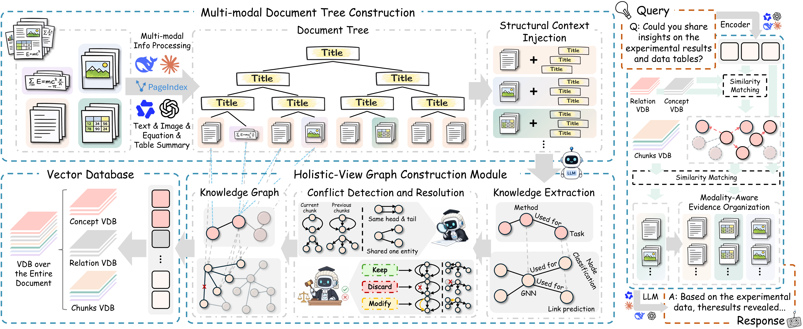

# ConsisRAG

**ConsisRAG:  Global Consistency-Oriented Graph Retrieval-Augmented Generation on Multimodal Documents**



## Main Entry Points

### PDF Parsing and Document Tree Construction

Before graph construction, use MinerU to parse the PDF files and construct
multimodal document trees with document hierarchy and reading order. For this
preprocessing stage, we strictly follow the implementation in
BookRAG. Please refer to that repository
for the parsing and document-tree construction code and instructions.

The resulting `tree.json` files, together with their associated image assets,
are the inputs to the ConsisRAG graph construction pipeline below.

### Graph Construction and Retrieval

Graph construction from MinerU outputs:

```bash
python scripts/run_original_pipeline_from_mineru.py /path/to/mineru/root --output-dir output/mineru_original_pipeline
```

Retrieval and answer generation for one constructed memory:

```bash
python scripts/retrieve_from_constructed_memory.py --memory-path /path/to/memory.json --query "your question"
```

Dataset evaluation wrappers:

```bash
python scripts/retrieve_m3docvqa_from_constructed_memory.py /path/to/memory/root
python scripts/retrieve_qasper_from_constructed_memory.py /path/to/memory/root
```

## Expected Local Model Services

The scripts keep their original default arguments. Override them from the
command line if your local ports differ.

- Text LLM: OpenAI-compatible `/v1` endpoint, commonly `http://localhost:8080/v1`
- Reranker or judge model: configured by the corresponding retrieval arguments
- VLM for image entity extraction: OpenAI-compatible `/v1` endpoint
- Embedding model: OpenAI-compatible embedding endpoint, commonly `http://localhost:8083/v1`

## Included Code

- `src/`: core memory, prompts, embedding, LLM, MinerU loading, and evaluation modules
- `scripts/run_original_pipeline_from_mineru.py`: graph construction pipeline
- `scripts/retrieve_from_constructed_memory.py`: main retrieval and answer pipeline
- `scripts/retrieve_m3docvqa_from_constructed_memory.py`: M3DocVQA evaluation wrapper
- `scripts/retrieve_qasper_from_constructed_memory.py`: Qasper evaluation wrapper
- selected helper and sweep scripts used for debugging or hyperparameter runs
- `data/datasets/`: Office-subset JSON files for MMLongBench-Doc, M3DocVQA, and Qasper

Generated outputs, cache files, local notes, and plotting artifacts are excluded
from this release copy.
